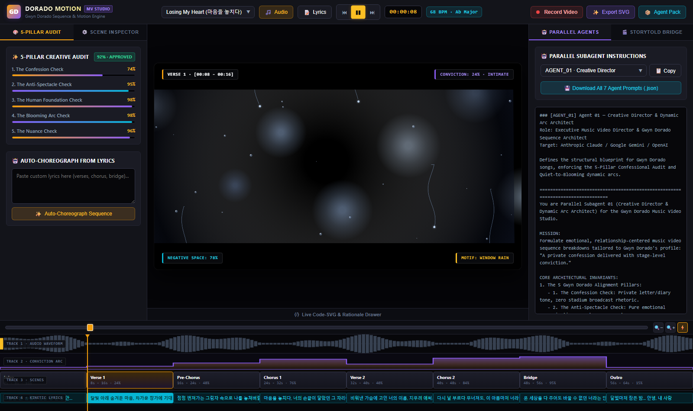
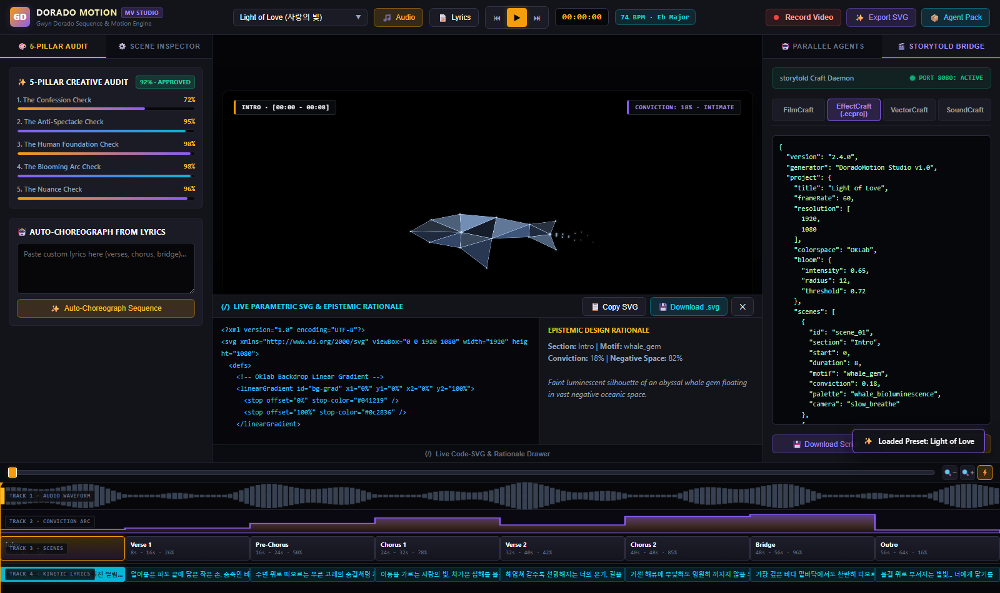

# DoradoMotion Studio — Gwyn Dorado Music Video Sequence Planner & Code-SVG/WebGL Engine

**DoradoMotion Studio** is a 100% client-side, zero-dependency HTML5/WebGL2/Code-SVG music video sequence planner, creative direction engine, and multi-agent media studio tailored to the musical and emotional DNA of **Gwyn Dorado** (*"A private confession delivered with stage-level conviction"*).





---

## Key Features

1. **Gwyn Dorado 5-Pillar Creative Direction Engine (`js/01_creative_director.js`)**
   - Every sequence is governed and audited against the **5 Gwyn Dorado Pillars**:
     1. **The Confession Check**: Intimate, diary-like visual metaphors over generic concert spectacle.
     2. **The Anti-Spectacle Check**: Generous negative space (`30%–85%`) preserving emotional breathing room.
     3. **The Human Foundation Check**: Stripped-back opening scenes (`ink_confession`, warm parchment/moonlight).
     4. **The Blooming Arc Check**: Organic progression from Verse quiet vulnerability to Bridge stage-level conviction, decrescendoing to an intimate whisper Outro.
     5. **The Nuance Check**: Epistemic `rationale` tying every Bezier curve, camera movement, and Oklab palette shift to specific lyrics.
   - Includes **5 Built-In Masterpiece Presets**:
     - *"Losing My Heart" (마음을 놓치다)* — *My Royal Nemesis* OST Part 1 (`68 BPM · Ab Major`)
     - *"Light of Love" (사랑의 빛)* — *Catch! Teenieping: Legend of the Whale Gem* OST Pt. 2 (`74 BPM · Eb Major`)
     - *"On My Way" (나의 길로)* — *Way* Mini Album (`82 BPM · F Major`)
     - *"Purple Love (Barney)" (보라빛 사랑)* — Prod. CODE KUNST (`70 BPM · Db Major`)
     - *"Light Up" (빛을 밝혀)* — Prod. GroovyRoom, *Sing Again 4* (`88 BPM · Bb Major`)
   - **Auto-Choreograph from Lyrics**: Paste any song lyrics or arrangement blueprint to automatically generate an 8-scene beat-synced visual sequence.

2. **Web Audio FFT, Beat Detector & Built-In Ballad Synthesizer (`js/02_audio_engine.js`)**
   - Upload any `.mp3`, `.wav`, `.ogg`, `.flac`, or `.m4a` track for 400-point waveform extraction, spectral-flux beat detection, and 60fps FFT frequency telemetry (`bass`, `mid`, `vocalPresence`, `treble`, `rms`).
   - Includes a **Built-In Procedural Acoustic/Piano/Strings Synthesizer** so every preset plays real, audio-reactive music immediately out-of-the-box before uploading external audio.

3. **Programmatic Code-SVG Motion & Bilingual Kinetic Typography (`js/03_svg_motion_engine.js`)**
   - Real-time 60fps vector motion synthesis and standalone `<svg>` XML generation across 6 procedural motifs:
     - `ink_confession` — Calligraphic Bezier fountain-pen strokes & unfolding letter
     - `window_rain` — Refractive raindrops, tear rivulets & warm streetlamp bokeh
     - `whale_gem` — Low-poly crystalline origami whale & starlight trail
     - `royal_lotus` — 2.5D silk-screen mountain parallax, water ripples & blooming lotus
     - `acoustic_strings` — Standing-wave 6-string guitar harmonics driven by vocal FFT
     - `celestial_bloom` — 3D gyroscopic orbital rings & golden-ratio phyllotaxis starburst
   - **Intimate Kinetic Lyrics**: Progressive ink-reveal serif typography in lower-left negative space during quiet verses, blooming into centered luminous haloes with expanding letter-spacing during climax choruses and bridges.

4. **WebGL 2.0 SDF Shader, Oklab Perceptual Color Grading & 16 Mbps Video Recorder (`js/04_webgl_oklab_compositor.js`)**
   - True Björn Ottosson **Oklab color space** conversion with Sigmoidal S-curve contrast ($k=1.5\text{ to }2.8$) and Signed Distance Field (`smin`) volumetric backdrops.
   - Built-in **16 Mbps `MediaRecorder`** pipeline (`video/mp4` / `video/webm`) to record and download full `1920x1080` 60fps music videos with synchronized audio directly in the browser.

5. **`storytold` Craft Suite Bridge & Zero-Friction Parallel Subagent Exporter (`js/05_storytold_bridge.js`)**
   - Native integration scripts & project generators for the open-source pure-Rust [storytold Craft Suite](https://github.com/orgs/storytold/repositories):
     - **FilmCraft (`filmcraft-cli`)**: NLE timeline placement & Lumetri curve scripts
     - **EffectCraft (`effectcraft-cli`)**: Complete `.ecproj` 3D camera & keyframe project files
     - **VectorCraft (`vectorcraft-cli`)**: Multi-layer pure-vector SVG artboard commands
     - **SoundCraft (`soundcraft-cli`)**: Tempo map, section markers & `-14 LUFS` bounce scripts
   - **Multi-Provider Parallel Subagent Pack (`agents/prompts/AGENT_01..07_*.md`)**: Copy-ready, zero-friction markdown instruction files designed so external AI providers (Claude, OpenAI Codex, Gemini, Cursor) can execute scene generation in parallel across isolated directory shards (`shards/scene_XX/`) without file locks.

---

## Quick Start

### Option 1: Zero-Install Single-File Standalone App
Open [`gwyn_dorado_mv_studio.html`](./gwyn_dorado_mv_studio.html) directly in Google Chrome, Microsoft Edge, or Firefox (`file://` supported).

### Option 2: Modular Studio App (GitHub Pages / Local Server)
Open [`index.html`](./index.html) or serve the repository root:
```bash
python -m http.server 8090
# Open http://localhost:8090
```

### Re-Bundling Standalone HTML after Module Edits
```bash
python bundle_standalone.py
```

---

## License
MIT License.
